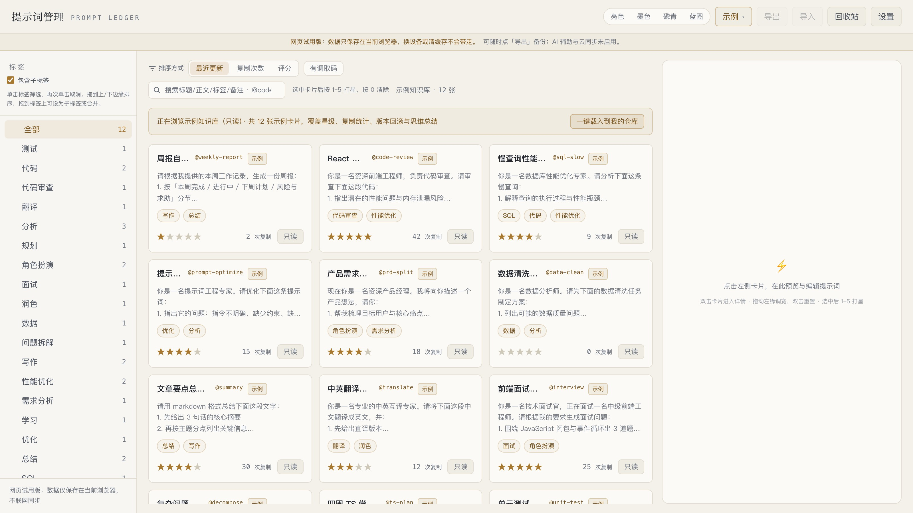
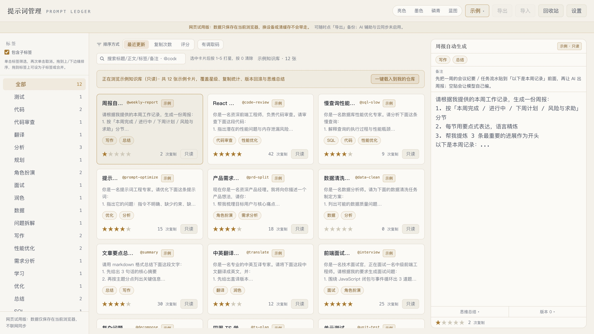

# Prompt Manager

[简体中文](./README.md) · English

> Keep scattered prompts in one searchable card library, see how often each one gets used, and let an MCP-capable AI assistant start working from a card with a single "retrieve <code>" line.





> Both screenshots come from the built-in read-only "example library" in the online trial (12 demo cards) and contain no real usage data.

## What it is

A prompt library that runs on your own computer. Paste a prompt body and it becomes a searchable card with a title and tags; filter by tag, sort by copy count or rating, compare and roll back body versions, and export a backup.

It also plugs into AI workflows: give a frequently used card a short "retrieval code", then say "retrieve weekly-report" in an MCP-capable client and the assistant uses that card's body as its system prompt. It suits individuals and small teams sharing one machine on a LAN; local mode needs no account.

## Core capabilities

- **Paste to create**: titles and tags are generated automatically (you can turn this off or edit them); duplicate bodies are flagged first.
- **Actually findable**: search title, body, tags, notes and retrieval code; `@code` jumps straight to a card; the tag tree expands and filters.
- **Gets more useful over time**: manual copies and MCP retrievals share one counter; rate 1–5 stars; sort by update time, copy count or rating.
- **Safe to edit**: every body save creates a version (up to 10) with diff and rollback; title, tags, notes and rating save on blur.
- **Your data stays yours**: local SQLite is the main store; Markdown / JSON import and export, trash, 10-second undo, and Docker self-hosting.
- **Fits into AI workflows**: a built-in MCP server with per-device, revocable tokens; works with WorkBuddy, Codex, Claude Code, Cursor and other MCP clients.

## Online trial

Open **[wanghoufan.github.io/p006-prompt-manager](https://wanghoufan.github.io/p006-prompt-manager/)** to try the interface.

The trial keeps data in the current browser's localStorage: AI features, cloud sync and MCP are disabled, and switching devices or clearing browser data leaves the cards behind. Use "Export" in the top bar for a backup. For daily use, run the full version locally or with Docker as described below.

## Quick Start (local)

You need Node.js 24+ and npm. An AI key is optional; the library works without one.

```bash
git clone https://github.com/wanghoufan/p006-prompt-manager.git
cd p006-prompt-manager
npm install
npm run dev
```

Open <http://localhost:3100>. The first start creates `data/prompt-manager.db` automatically (SQLite, WAL mode).

To let AI generate titles and tags: choose a provider and enter an API key under "Settings → AI service", or put the key in `.env.local` (see `.env.local.example`) for the server to read. Supported providers: DeepSeek official, OpenRouter, and OpenCode (Zen and Go endpoints).

Common commands:

```bash
npm run build   # production build (standalone)
npm run start   # preview the production build on 3100 (prints a standalone notice; safe to ignore)
npm run lint
```

Backup and restore:

```bash
bash scripts/backup-sqlite.sh backup
bash scripts/backup-sqlite.sh list
bash scripts/backup-sqlite.sh restore <backup-file>
```

## Docker self-hosting

```bash
cp docker/env.template .env.local
# Edit .env.local: at minimum set PROMPT_MANAGER_DATA_DIR (absolute host path)
mkdir -p /your/data/directory
docker compose --env-file .env.local up -d --build
```

Open `http://<host>:3100`. The SQLite database and backups live under `PROMPT_MANAGER_DATA_DIR`, so rebuilding the container keeps your data. This is meant for a trusted LAN: local mode has no user accounts, so do not expose port 3100 directly to the internet.

## Retrieve prompts from an AI assistant (MCP)

1. Under "Settings → MCP local access", generate a token for this machine (shown once).
2. From the project root, run:

   ```bash
   node mcp/prompt-server/setup.mjs
   ```

   The script installs the sub-package dependencies, builds the MCP server, detects local clients and writes their configuration, then verifies the protocol. Use `--check` for a read-only health check, or `--client=<id>` for one client. Manual setup and other options are in [mcp/prompt-server/README.md](mcp/prompt-server/README.md).
3. Start a new client session and say "**retrieve <code>**". The card body becomes the system prompt for that turn, and the card's copy count goes up by one.

MCP talks to the local HTTP API, so Prompt Manager must be running. Each computer gets its own token, which can be revoked in settings if lost or no longer needed.

## Data and boundaries

- **Local first**: a single SQLite database is the main store; devices on the LAN sync through the same server. Local mode has no user isolation — anyone who can open the page can edit the data.
- **Cloud is optional**: cloud sync and login (the fallback path) only turn on after you configure a Supabase public URL and publishable key. Without them the app is purely local.
- **AI is an external service**: when AI features run, the prompt body is sent to the provider you selected. The key lives in local settings or `.env.local` and is never committed.
- **The static trial** is only for a quick look at the interface; it does not use the local database and does not support AI, MCP or cloud sync.
- **License**: the repository currently ships no open-source license. Contact the author before reusing the code.

## Project layout

```text
src/app/                pages and route handlers (AI proxy, sync, MCP tokens)
src/components/         cards, detail, tags, settings and other UI
src/lib/                cards / tags / storage / AI adapters
db/migrations/          SQLite schema migrations
mcp/prompt-server/      MCP server and one-command setup script
Dockerfile / compose.yaml
```

## More

- MCP setup: [mcp/prompt-server/README.md](mcp/prompt-server/README.md)
- Product requirements: [docs/pm/提示词管理工具-需求文档.md](docs/pm/提示词管理工具-需求文档.md)
- Quality log: [docs/qa/BUGS.md](docs/qa/BUGS.md)
